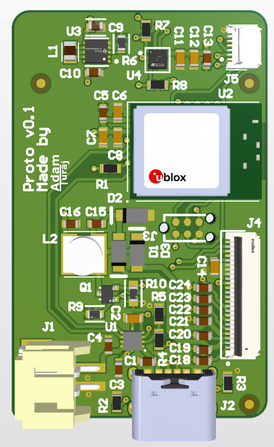

# E-Ink Screen Driver

A compact board for running a touch-enabled e-ink display on battery power, with Bluetooth Low Energy, USB-C charging, and onboard motion sensing.

## Design files

Open [Business_Idea_PCB.PrjPcb](Business_Idea_PCB.PrjPcb) in Altium Designer to view the schematics and PCB layout. The board has a Tag-Connect footprint for SWD programming and debugging.
